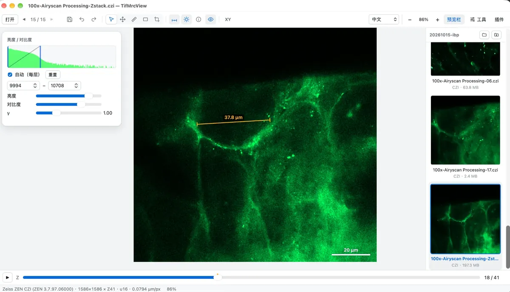

[English](README.md) | [简体中文](README.zh-CN.md) | **Deutsch** | [日本語](README.ja.md) | [Español](README.es.md) | [Français](README.fr.md) | [Русский](README.ru.md)

# TifMrcView

Ein kleiner, schneller und bequemer Viewer für Mikroskopie- und Elektronenmikroskopie-Bilder: TIFF / OME-TIFF / ImageJ, MRC für Kryo-EM und Kryo-ET, Zeiss CZI und SmartSEM. Zeichnen Sie Linien, Rechtecke und Kreise mit Messwerten in physikalischen Einheiten, wechseln Sie zwischen XY-, XZ- und YZ-Ansicht und betrachten Sie mehrkanalige Fluoreszenzbilder mit kanalweisem Ein-/Ausblenden und eigenen Farben. Das Installationspaket ist nur wenige MB groß und öffnet trotzdem mehrere GB große Stapel sofort. Läuft unter macOS, Windows und Linux und lässt sich mit Plugins erweitern. Entwickelt mit Rust + Tauri 2.

[](https://tifmrcview.com/tifmrcview/#download)
[](LICENSE)

[](https://github.com/Leehow/TifMrcView)

**[Download](https://tifmrcview.com/tifmrcview/#download)** · **[Plugin-Markt](https://tifmrcview.com/tifmrcview/plugins/)** · [Website](https://tifmrcview.com/tifmrcview/)

> Wenn Ihnen TifMrcView gefällt, geben Sie dem Projekt bitte einen ⭐ auf GitHub – das hilft wirklich.

## Screenshots

<table>
  <tr>
    <td width="50%"><a href="site/shots/mrc-tomogram-line.webp"></a><br><sub>Kryo-ET-Tomogramm (MRC) mit Längenmessung und den Annotationswerkzeugen.</sub></td>
    <td width="50%"><a href="site/shots/mrc-xz-view-box.webp"></a><br><sub>XZ-Seitenansicht mit einem Rechteck, das Breite × Höhe anzeigt.</sub></td>
  </tr>
  <tr>
    <td width="50%"><a href="site/shots/czi-airyscan-measure.webp"></a><br><sub>Zeiss-CZI-Airyscan-Z-Stapel mit Messung und Maßstabsbalken.</sub></td>
    <td width="50%"><a href="site/shots/tiff-multichannel.webp"></a><br><sub>Fluoreszenz-TIFF mit 3 Kanälen und kanalweisem Ein-/Ausblenden.</sub></td>
  </tr>
</table>

## Funktionen

- Unterstützte Formate: TIFF (mehrseitig, Streifen/Kacheln, Kompression LZW/Deflate/PackBits/JPEG, Graustufen mit 1–7 Bit wie 1-Bit-Binär und 4 Bit sowie 8/16/32-Bit-Ganzzahl und Gleitkomma; unübliche Tiefen wie 12 Bit führen zu einer eindeutigen Fehlermeldung), OME-TIFF (liest C/Z/T-Dimensionen, Kanalnamen und -farben, Pixelgröße), ImageJ-Hyperstacks (auch zusammenhängend gespeicherte Dateien über 4 GB), Paletten-TIFF (z. B. Zeiss-SEM-Bilder), MRC/MRC2014 (Modi 0/1/2/3/4/6/12/101, `.mrc` `.mrcs` `.rec` `.st` `.map`; bei Mode-0-Dateien ohne IMOD-Kennzeichen wird anhand von Minimum/Maximum im Header entschieden, ob es sich um vorzeichenlose Bytes handelt) und mit dem Plugin Zeiss ZEN auch Zeiss CZI (LSM / Airyscan usw., von ZEN gespeichert: unkomprimierte, Zstd- und JPEG-Subblöcke, 8/16/32-Bit-Graustufen und Farbe, C/Z/T-Dimensionen, gekachelte Mosaike, Kanalnamen und -farben, Pixelgröße). `.rec` `.st` `.map` und `.czi` erscheinen nur unter „Öffnen mit“ und werden nicht als Standardprogramm gesetzt
- Öffnet außerdem PNG / JPEG / BMP / GIF / WebP
- Z-Regler und Wiedergabe; bei vorhandener Zeitdimension zusätzlich ein T-Regler
- Mehrkanal-Farbüberlagerung: Kontrollkästchen blendet einen Kanal ein/aus, Klick auf den Namen stellt den Kontrast dieses Kanals ein, Klick auf den Punkt ändert seine Farbe
- Helligkeit / Kontrast / Gamma; im Histogramm ziehen, um den Anzeigebereich direkt zu wählen; standardmäßig automatischer Kontrast pro Schicht (0,1 % Sättigung)
- Die ⓘ-Schaltfläche der Werkzeugleiste zeigt Bildinformationen: Format, Größe, Pixelgröße und von Plugins gelesene Aufnahmeparameter (durchsuchbar und kopierbar). Das Plugin Zeiss SmartSEM liest alle Parameter eines Zeiss-SEM-Bildes (Spannung, Arbeitsabstand, Vergrößerung, Detektor, Probentischposition, Vakuum, …) und zeigt anhand der kalibrierten Pixelgröße einen Maßstabsbalken; das Plugin Zeiss ZEN liest aus einer CZI-Datei Mikroskop, Objektiv, Laser, Detektoren, Pinhole, Scan- und Airyscan-Verarbeitungsparameter
- Eine Vorschauleiste rechts listet die Bilder im selben Ordner (einklappbar) mit Dateiname, Format und Größe
- Symbolleiste oben (Namen beim Überfahren): Bild speichern, Rückgängig, Auswählen, Verschieben, Messen, Stift (erneut klicken wechselt zwischen Freihand / Rechteck / Kreis), Zuschneiden, Maßstabsbalken, Helligkeit/Kontrast
- Messungen zeigen reale Längen anhand der Pixelgröße; Rechtecke und Kreise zeigen im Bild stets Breite × Höhe (bei einem echten Kreis den Durchmesser)
- Auswahlwerkzeug (Standard): leere Fläche ziehen verschiebt das Bild; eine Annotation anklicken und ziehen, an den Punkten auf dem Rand skalieren, die Endpunkte einer Messlinie ziehen, um neu zu messen; Entf löscht; Farbe und Linienstärke sind änderbar
- Annotationen werden pro Z-Schicht gespeichert und etwa 2 Sekunden nach dem Zeichnen automatisch in `<Dateiname>.annot.json` neben dem Bild abgelegt; beim nächsten Öffnen werden sie wieder gelesen
- Zuschneiden: Bereich aufziehen, dann Doppelklick oder Eingabetaste, um nur diesen Ausschnitt zu sehen; Esc oder Rücktaste macht es rückgängig
- Ein gleichnamiges IMOD-Modell (`.mod` / `.fid`) wird automatisch überlagert und lässt sich pro Objekt ein-/ausschalten
- Bild speichern: PNG in Originalauflösung (nach dem Zuschneiden nur der zugeschnittene Bereich), mit sichtbaren Annotationen, Modell und Maßstabsbalken
- Bilder mit Z lassen sich oben zwischen XY-, XZ- und YZ-Ansicht umschalten (in Seitenansichten gezeichnete Annotationen werden nicht gespeichert)
- Am inneren Rand der linken Werkzeugleiste und der rechten Vorschauleiste ziehen, um die Breite zu ändern
- Mausrad zum Zoomen, Ziehen zum Verschieben, Doppelklick zum Einpassen ins Fenster; die Statusleiste zeigt Pixelkoordinaten und Rohwert
- Datei ins Fenster ziehen, um sie zu öffnen; ein Doppelklick auf eine andere Datei im selben Ordner öffnet sie im bestehenden Fenster, eine Datei aus einem anderen Ordner öffnet ein neues Fenster
- Die Schaltfläche „Ordner öffnen“ oben in der Vorschauleiste zeigt das aktuelle Bild im Finder / Explorer
- Bei jedem anderen Werkzeug schaltet ein Rechtsklick auf das Bild zurück zum Auswahlwerkzeug
- Eine Annotation kann auf einer einzelnen Schicht oder über einen Z-Bereich sichtbar sein; nach dem Auswählen ändert man das Z oben, und der Z-Regler markiert die Schichten mit Annotationen

## Plugins

Im Menü „Plugins“ der Werkzeugleiste lassen sich Plugins ein-/ausschalten, installieren, deinstallieren und auf Updates prüfen. Mit Ausnahme der Sprachen wird jedes Plugin einzeln installiert: Über „Plugin-Markt“ öffnet sich https://tifmrcview.com/tifmrcview/plugins/ im Browser, dort laden Sie ein Plugin-Paket (.zip) herunter und wählen es danach über „Plugin laden…“ aus. Wird eine neuere Version desselben Plugins installiert, ersetzt sie die alte. Die Plugin-Quellen liegen im Repository unter `plugins/<id>/` (`plugin.json` + `index.js`; derzeit `recorder`, `smartsem` und `zen`); installierte Plugins liegen im Unterordner `<id>/` des Plugin-Ordners.

Installation mit einem Klick (ab 0.5): Auf einer Plugin-Karte im Plugin-Markt oder in der Liste „Plugin-Markt“ im Plugins-Menü auf **Installieren** klicken (dort steht bei neueren Versionen „Auf x.y.z aktualisieren“). Die Website übergibt der App einen Link der Form `tifmrcview://install-plugin?id=<id>` (optional `&version=<x.y.z>`); die App zeigt Name und Beschreibung des Plugins und installiert erst, wenn du **Installieren** klickst. Installiert werden nur Plugins aus dem offiziellen Plugin-Markt (`plugins.json` neben dem Update-Feed), geladen über HTTPS und vor der Installation auf Größe und SHA-256 geprüft. ZIP herunterladen und „Plugin installieren…“ funktioniert weiterhin.

Format-Plugins: Ein Plugin-Paket kann außerdem Dateiformate und Metadaten-Leser als WebAssembly-Modul in einer Sandbox mitbringen, etwa in Rust mit dem SDK in `plugins/sdk` geschrieben. Zeiss CZI (`zen`) und Zeiss SmartSEM (`smartsem`) funktionieren so; das Programm selbst enthält keinen herstellerspezifischen Formatcode: Ohne das Plugin Zeiss ZEN lassen sich .czi-Dateien nicht öffnen, und die App sagt, welches Plugin nötig ist. Ein Modul sieht nur die gerade geöffnete Datei, läuft mit Speicher- und Zeitlimits und beschreibt jede Seite als Liste von Dateiabschnitten, die die App selbst parallel dekomprimiert und zusammensetzt. ABI, Grenzen und ein Beispiel: [docs/format-plugins.md](docs/format-plugins.md).

Plugin „Video aufnehmen“: Im Werkzeug-Panel unter „Video aufnehmen (MP4)“ wählen Sie Z oder T, Start- und Endbild, Bildrate, Bereich (ganzes Bild / Auswahl / aktueller Ausschnitt), Größe und Qualität. Das erzeugte H.264-MP4 enthält den aktuellen Kontrast, die Kanalfarben, Annotationen und den Maßstabsbalken.

Die Oberflächensprache ist ebenfalls ein eingebautes Plugin (`ui/plugins/i18n.js`): Es unterstützt 中文, English, Deutsch, 日本語, Español, Français und Русский, folgt standardmäßig der Systemsprache und lässt sich über das Auswahlfeld in der Werkzeugleiste umstellen. Es ersetzt die bekannten chinesischen Texte der Oberfläche durch die gewählte Sprache, sodass auch andere Plugins und Meldungen mitübersetzt werden; für neuen Text fügen Sie eine Zeile in `WORDS` (feste Texte) oder `PATTERNS` (Texte mit Zahlen oder Dateinamen) hinzu. Wird dieses Plugin ausgeschaltet, erscheint wieder Chinesisch.

Eigene Plugins schreiben: Legen Sie eine `.js`-Datei in den Plugin-Ordner und klicken Sie auf „Neu laden“. Zum Weitergeben packen Sie `plugin.json` (`id`, `name`, `version`, `description`, `main`, `apiVersion`, `minAppVersion`, optional `author`, `i18n`, `details`; Format siehe `plugins/recorder/plugin.json`) zusammen mit dem Skript in eine ZIP-Datei (Dateien im Stammverzeichnis der ZIP). Ein minimales Beispiel:

```js
TifMrcView.register({
  id: "hello",
  name: "Hello plugin",
  version: "1.0.0",
  description: "Shows the current slice in the tools panel",
  activate(app) {
    const box = app.ui.addToolSection("Hello");
    app.on("slice", ({ z }) => (box.textContent = `Slice ${z + 1}`));
  },
});
```

`app` stellt bereit: `state()` (aktuelle Datei, Z/T, Größe, Auswahl, Pixelgröße), `on("open" | "slice" | "render", fn)`, `setZ` / `setT` / `open(path)`, `renderRegion(region, {z, t, size})` (rendert mit den aktuellen Anzeigeeinstellungen auf ein Canvas, inklusive Annotationen und Maßstabsbalken), `ui.addToolSection` / `ui.addToolbarButton` / `ui.addToolbarSelect` / `ui.toast` / `ui.busy`, `dialog.save`, `fs.write`, `settings.get/set` sowie `native(method, args, bytes)` zum Aufruf der Rust-Seite. Die vollständige Definition steht in `ui/plugin-host.js`. Plugins, die nativen Code benötigen (etwa der H.264-Encoder der Aufnahme), implementieren `NativePlugin` in `src-tauri/src/plugins/`; der native Teil wird ins Hauptprogramm einkompiliert, aber erst aktiviert, wenn ein Plugin-Paket mit derselben id installiert ist. Ob die Aufnahme einkompiliert wird, steuert ein Cargo-Feature (`recorder` ist standardmäßig aktiv; mit `--no-default-features` entfällt es und das Installationspaket wird etwa 1 MB kleiner).

Plugins haben dieselben Rechte wie das Hauptprogramm: Installieren Sie nur Plugins, denen Sie vertrauen.

## Automatische Updates

Wenige Sekunden nach dem Start prüft die App im Hintergrund `https://tifmrcview.com/tifmrcview/latest.json`. Gibt es eine neue Version, erscheint oben eine Hinweisleiste; „Jetzt aktualisieren und neu starten“ lädt das Update herunter, prüft die Signatur, installiert es und startet neu. Update-Pakete sind mit einem Tauri-minisign-Schlüssel signiert; der öffentliche Schlüssel steht in `tauri.conf.json`.

## Tastenkürzel

| Taste | Aktion |
| --- | --- |
| ↑ / ↓ | Vorherige / nächste Datei |
| ← / →, PageUp / PageDown, `,` / `.` | Z wechseln |
| Pos1 / Ende | Erste / letzte Schicht |
| Leertaste | Z abspielen / pausieren |
| Strg + Mausrad (⌘ + Mausrad unter macOS), Umschalt + Mausrad | Z wechseln |
| S / V / M / P / R / E / C | Auswählen / Verschieben / Messen / Stift / Rechteck / Kreis / Zuschneiden |
| Umschalt (beim Zeichnen von Rechteck oder Kreis) | Quadrat / echter Kreis |
| Entf / Rücktaste | Ausgewählte Annotation löschen; ohne Auswahl das Zuschneiden rückgängig machen |
| Esc | Gerade gezeichnete Annotation abbrechen, Auswahl aufheben, Zuschneiden rückgängig machen |
| Eingabetaste, Doppelklick auf den Zuschneiderahmen | Zuschneiden |
| Strg/⌘ + Z | Rückgängig (Zeichnen, Messen, Verschieben, Löschen und Zuschneiden sind rückgängig machbar) |
| Strg/⌘ + Umschalt + Z, Strg/⌘ + Y | Wiederholen |
| Strg/⌘ + S | PNG speichern (standardmäßig neben dem Bild oder im im Werkzeug-Panel gewählten Speicherordner) |
| H | Annotationen ein-/ausblenden |
| I | IMOD-Modell ein-/ausblenden |
| T | „Werkzeug“-Panel öffnen / einklappen |
| B | Vorschauleiste ein-/ausblenden |
| F, Doppelklick (Verschieben-Werkzeug) | Ins Fenster einpassen |
| 1 | Originalgröße (1:1) |
| + / =, - | Vergrößern / Verkleinern |
| Strg/⌘ + O | Datei öffnen |

## Warum es schnell ist

- Dateien werden per Memory-Mapping gelesen, und die Streifen/Kacheln einer Seite werden parallel auf allen CPU-Kernen dekomprimiert
- Nach dem Öffnen werden im Hintergrund die übrigen Z-Schichten, von der aktuellen aus nach Nähe geordnet, in den Speicher vorab dekodiert (etwa ein Viertel des Arbeitsspeichers, 512 MB–8 GB), sodass beim Ziehen des Reglers sofort Bilder erscheinen
- Es wird nur der sichtbare Bereich und nur in Bildschirmauflösung gerendert; die 8-Bit-RGBA-Daten gehen binär an die Oberfläche, daher bleiben Zoomen und Verschieben bei 4000×4000-Bildern flüssig
- Vorschaubilder entstehen in einem eigenen Thread-Pool und konkurrieren nicht mit dem aktuellen Bild um die CPU
- Die Oberfläche ist reines HTML/JS ohne Frontend-Framework; Release-Builds nutzen LTO und strip, die Installationspakete sind etwa 4–11 MB groß (das Linux-AppImage enthält WebKit und ist daher etwa 84 MB groß)

## Installation

Laden Sie TifMrcView von der offiziellen Website **[tifmrcview.com/tifmrcview](https://tifmrcview.com/tifmrcview/#download)** herunter. Neue Versionen erscheinen häufig und nur dort (GitHub Releases werden nicht verwendet); die App aktualisiert sich ebenfalls von dort:

- **macOS** (10.15 oder neuer): `TifMrcView_x.y.z_universal.dmg` (Intel und Apple Silicon), in „Programme“ ziehen. Da die App keine Apple-Entwicklersignatur hat, wird der erste Start blockiert: Gehen Sie zu „Systemeinstellungen → Datenschutz & Sicherheit“ und klicken Sie auf „Trotzdem öffnen“, oder führen Sie im Terminal `xattr -dr com.apple.quarantine /Applications/TifMrcView.app` aus. Beim ersten Start macht sich TifMrcView selbst zum Standardprogramm für .tif/.tiff/.mrc.
- **Windows**: `TifMrcView_x.y.z_x64-setup.exe`, per Doppelklick installieren (keine Administratorrechte nötig). Das Installationsprogramm registriert die Zuordnungen für .tif/.tiff/.mrc; falls Sie früher für .tif manuell ein anderes Programm gewählt haben (z. B. „Fotos“), erlaubt Windows es Software nicht, das stillschweigend zu ändern – klicken Sie in TifMrcView auf „Als Standard festlegen“, wodurch die Systemeinstellungen geöffnet werden, und wählen Sie dort TifMrcView aus.
- **Linux**: `.deb` für Debian/Ubuntu, `.rpm` für Fedora und ähnliche, `.AppImage` für andere Distributionen. Beim ersten Start wird die App über `xdg-mime` als Standardprogramm gesetzt.

## Aus dem Quellcode bauen

Benötigt werden Rust (stable) und Node.js 18+. Unter Linux zusätzlich:

```sh
sudo apt install libwebkit2gtk-4.1-dev libgtk-3-dev librsvg2-dev libxdo-dev libssl-dev
```

Dann:

```sh
npm install
npm run dev      # Entwicklungsmodus
npm run build    # Installationspaket für das aktuelle System erzeugen, in src-tauri/target/release/bundle/
```

Zum Debuggen der Dekodierung gibt es ein mitgeliefertes kleines Werkzeug; es gibt Metadaten, Pixel je Kanal sowie Dekodier-/Renderzeiten aus:

```sh
cd src-tauri && cargo run --release --example probe -- /path/to/file.tif
```

## Veröffentlichung

Versionsnummern werden automatisch erzeugt: Haupt- und Nebenversion aus `tauri.conf.json` (derzeit 0.3) plus die Gesamtzahl der Commits, z. B. `0.3.57`; bei einem Tag `v1.2.3` wird die Version des Tags verwendet.

Bei jedem Push auf `main` baut GitHub Actions Pakete für macOS / Windows / Linux; die Installationspakete liegen in den Artifacts des Laufs. Auf die Download-Seite wird auf zwei Wegen veröffentlicht:

- Einen Tag mit Präfix `v` pushen: `git tag v0.3.0 && git push origin v0.3.0` lädt auf die Download-Seite hoch und erstellt ein GitHub Release;
- oder den Build in Actions manuell starten und „auf der Download-Seite veröffentlichen“ ankreuzen; veröffentlicht wird mit der automatischen Versionsnummer.

Beim Veröffentlichen legt die CI Installations- und Update-Pakete im Verzeichnis `<Version>/` der Download-Seite ab und aktualisiert zuletzt `latest.json` (für die automatische Aktualisierung) und `downloads.json` (für die Download-Seite). Die Download-Seite und der Plugin-Markt (`site/`, `plugins/`) werden außerdem von einem eigenen Workflow (`.github/workflows/site.yml`) bereitgestellt, sobald sie sich auf `main` ändern. Folgendes ist im Repository unter Settings → Secrets and variables → Actions zu konfigurieren:

| Name | Typ | Beschreibung |
| --- | --- | --- |
| `TAURI_SIGNING_PRIVATE_KEY` | Secret | Privater Schlüssel zum Signieren der Update-Pakete (geht er verloren, können keine Updates mehr an installierte Nutzer verteilt werden) |
| `TAURI_SIGNING_PRIVATE_KEY_PASSWORD` | Secret, optional | Passwort dieses Schlüssels, falls vorhanden |
| `DEPLOY_SSH_KEY` | Secret | Privater SSH-Schlüssel des Deploy-Benutzers der Download-Seite |
| `DEPLOY_HOST` / `DEPLOY_USER` | Secret | Host und Benutzername der Download-Seite |
| `UPDATE_BASE_URL` | Variable, optional | Standard `https://tifmrcview.com/tifmrcview` |
| `DEPLOY_PATH` | Variable, optional | Standard `/var/www/tifmrcview` |

## Projektstruktur

| Pfad | Inhalt |
| --- | --- |
| `src-tauri/src/formats/` | Dekoder: `tiff.rs`, `mrc.rs`, `raster.rs` (PNG/JPEG/…), `mod.rs` |
| `src-tauri/src/` | `lib.rs` (Befehle, Fenster- und Dateiverwaltung), `render.rs`, `reslice.rs` (XZ-/YZ-Ansichten), `image.rs`, `imod.rs` (IMOD-Modelle), `mem.rs`, `assoc.rs` (Registrierung als Standardprogramm), `update.rs` |
| `src-tauri/src/plugins/` | Native Plugin-Teile (`recorder.rs`, `mp4.rs`), Plugin-Pakete (`package.rs`) und der WebAssembly-Host für Format-Plugins (`wasm.rs`, `recipe.rs`, `registry.rs`) |
| `src-tauri/examples/probe.rs` | Das Dekodier-Prüfwerkzeug |
| `ui/` | Reines HTML/JS-Frontend: `index.html`, `app.js`, `style.css`, `plugin-host.js`; eingebautes Sprach-Plugin in `ui/plugins/i18n.js` |
| `plugins/<id>/` | Quellen der installierbaren Plugins (`recorder`, `smartsem`, `zen`; die beiden letzten sind nach WebAssembly gebaute Rust-Crates) und das Plugin-SDK (`sdk`) |
| `scripts/` | `pack-plugins.mjs` (erstellt Plugin-ZIPs und den Markt-Index), `make-release.mjs` |
| `site/` | Die Website und der Plugin-Markt, Screenshots in `site/shots/` |
| `packaging/linux/` | Linux-Paketierungsdateien (MIME-Typ für .mrc) |
| `.github/workflows/` | `build.yml` (Build und Release), `site.yml` (Bereitstellung von Website und Plugin-Markt) |

## Übersetzungen

Die README gibt es in mehreren Sprachen (siehe die Sprachzeile ganz oben). **Die englische README (`README.md`) ist die maßgebliche Quelle**; die anderen Dateien behalten exakt dieselben Abschnitte in derselben Reihenfolge. Wenn Sie `README.md` ändern, aktualisieren Sie bitte auch die Übersetzungen oder eröffnen Sie ein Issue, falls Ihnen das nicht möglich ist.

## Lizenz

Dieses Projekt ist unter der [Apache License 2.0](LICENSE) quelloffen.
