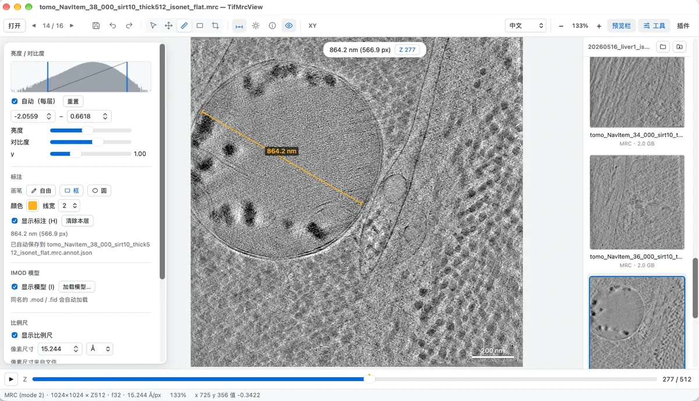
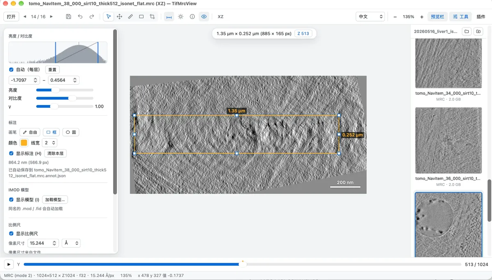
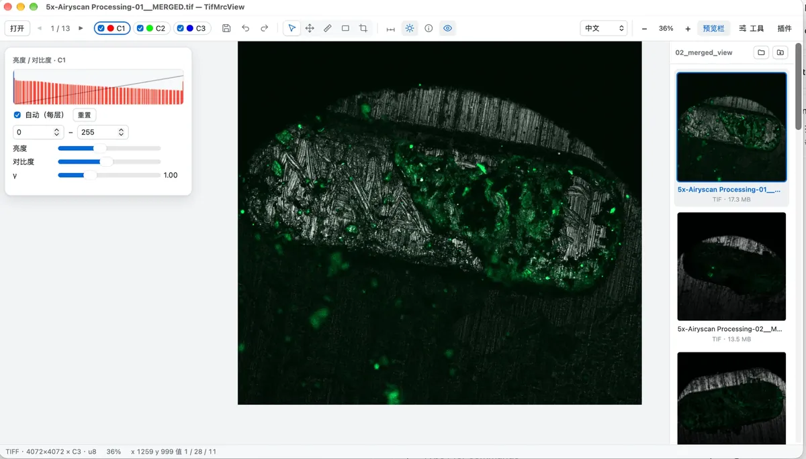

[English](README.md) | [简体中文](README.zh-CN.md) | [Deutsch](README.de.md) | **日本語** | [Español](README.es.md) | [Français](README.fr.md) | [Русский](README.ru.md)

# TifMrcView

顕微鏡・電子顕微鏡画像のための、小さくて速く、使いやすいビューアです。TIFF / OME-TIFF / ImageJ、クライオ電顕・クライオ電子線トモグラフィー用の MRC、Zeiss CZI、SmartSEM に対応します。線・矩形・円を描いて物理単位で計測でき、XY / XZ / YZ ビューを切り替えられ、多チャンネル蛍光画像ではチャンネルごとの表示切替と色変更ができます。インストーラーはわずか数 MB ですが、数 GB のスタックも瞬時に開きます。macOS、Windows、Linux で動作し、プラグインで拡張できます。Rust + Tauri 2 で作られています。

[](https://tifmrcview.com/tifmrcview/#download)
[](LICENSE)

[](https://github.com/Leehow/TifMrcView)

**[ダウンロード](https://tifmrcview.com/tifmrcview/#download)** · **[プラグインマーケット](https://tifmrcview.com/tifmrcview/plugins/)** · [ウェブサイト](https://tifmrcview.com/tifmrcview/)

作者：**Hao Li** · [ORCID](https://orcid.org/0009-0004-2696-3267) · [@Leehow](https://github.com/Leehow) · [lihao9x@iccas.ac.cn](mailto:lihao9x@iccas.ac.cn)

> TifMrcView が役に立ったら、GitHub で ⭐ を付けていただけるととても励みになります。

## スクリーンショット

<table>
  <tr>
    <td width="50%"><a href="docs/shots/mrc-tomogram-line.webp"></a><br><sub>MRC 形式のクライオ電子線トモグラム。長さ計測とアノテーションツール。</sub></td>
    <td width="50%"><a href="docs/shots/mrc-xz-view-box.webp"></a><br><sub>XZ 側面ビュー。矩形に幅 × 高さを表示。</sub></td>
  </tr>
  <tr>
    <td width="50%"><a href="docs/shots/czi-airyscan-measure.webp"></a><br><sub>Zeiss CZI Airyscan の Z スタック。計測とスケールバー付き。</sub></td>
    <td width="50%"><a href="docs/shots/tiff-multichannel.webp"></a><br><sub>3 チャンネル蛍光 TIFF。チャンネルごとに表示を切り替え可能。</sub></td>
  </tr>
</table>

## 機能

- 対応フォーマット：TIFF（マルチページ、ストリップ/タイル、LZW/Deflate/PackBits/JPEG 圧縮、1 ビット二値や 4 ビットなどの 1〜7 ビットグレースケール、8/16/32 ビットの整数と浮動小数点。12 ビットなど一般的でないビット深度は明確なエラーメッセージを表示）、OME-TIFF（C/Z/T 次元、チャンネル名と色、ピクセルサイズを読み取り）、ImageJ ハイパースタック（4 GB を超える連続格納ファイルを含む）、パレット TIFF（Zeiss SEM 画像など）、MRC/MRC2014（mode 0/1/2/3/4/6/12/101、`.mrc` `.mrcs` `.rec` `.st` `.map`。IMOD フラグのない mode 0 ファイルは、ヘッダーの最小値/最大値から符号なしバイトかどうかを判定）、SerialEM モンタージュ（グリッドマップ・アトラスマップ。`.mdoc` または拡張ヘッダーのピース座標でつなぎ合わせ、個々のピースは 2 つ目の画像として残る）、Zeiss プラグインを入れれば Zeiss CZI（ZEN で保存された LSM / Airyscan など：非圧縮、Zstd、JPEG サブブロック、8/16/32 ビットのグレースケールとカラー、C/Z/T 次元、タイル状モザイク、チャンネル名と色、ピクセルサイズ）。`.rec` `.st` `.map` と `.czi` は「このアプリケーションで開く」にのみ表示され、既定のアプリには設定されません
- PNG / JPEG / BMP / GIF / WebP も開けます
- Z スライダーと再生。時間次元がある場合は T スライダーも表示
- ボリューム EM（FIB-SEM、連続切片、SBF-SEM）：スライス画像のフォルダーを 1 つの Z スタックとして開けます（フォルダーをウィンドウにドロップ、またはフォルダーボタン / Ctrl/⌘+Shift+O）。スライスはアプリが開ける形式ならどれでもよく、必要になったときだけ読み込みます。近くの取得プロジェクトファイルをプラグインが認識すると（`thermo` プラグインでの Thermo Fisher Auto Slice & View の `ProjectData.dat`）、そのフォルダーのサムネイル一覧にスタックの項目が加わり、スライス厚が Z 間隔になります。プロジェクトファイルがない場合は「スケールバー」で Z 間隔を入力できます
- 多チャンネルのカラー合成：チェックボックスでチャンネルを表示/非表示、名前をクリックしてそのチャンネルのコントラストを調整、丸印をクリックして色を変更
- 明るさ / コントラスト / γ。ヒストグラム上をドラッグして表示範囲を直接指定。既定ではスライスごとの自動コントラスト（飽和 0.1%）
- ツールバーの ⓘ ボタンで画像情報を表示：フォーマット、サイズ、ピクセルサイズ、およびプラグインが読み取った撮影パラメーター（検索・コピー可能）。プラグイン Zeiss は Zeiss SmartSEM の SEM 画像から電圧、作動距離、倍率、検出器、ステージ位置、真空などの全パラメーターを読み取り、校正済みピクセルサイズでスケールバーを表示します。また CZI から顕微鏡、対物レンズ、レーザー、検出器、ピンホール、スキャン、Airyscan 処理パラメーターを読み取ります
- 右側のプレビューバー（折りたたみ可）に同じフォルダー内の画像をファイル名・フォーマット・サイズ付きで一覧表示
- 上部のアイコンツールバー（ホバーで名前を表示）：画像保存、元に戻す、選択、移動、計測、ペン（右の小さな矢印でメニュー：自由線 / 直線 / 矢印 / 矩形 / 円）、テキスト、トリミング、スケールバー、明るさ/コントラスト
- 計測はピクセルサイズに基づく実際の長さを表示。矩形と円は画像上に常に幅 × 高さを表示（正円は直径）
- 選択ツール（既定）：空白部分のドラッグで画像を移動、注釈をクリックしてドラッグ、枠上の点をドラッグして拡大縮小、計測線の端点をドラッグして計測し直し、Delete で削除、色と線幅の変更が可能
- 注釈は Z スライスごとに保存され、描画の約 2 秒後に画像と同じ場所の `<ファイル名>.annot.json` へ自動保存され、次回開いたときに自動で読み込まれます
- トリミング：範囲を囲んでダブルクリックまたは Enter でその部分だけを表示。Esc または Backspace で取り消し
- 同名の IMOD モデル（`.mod` / `.fid`）が自動的に重ねて表示され、オブジェクトごとに切替可能
- 画像保存：元の解像度で PNG を保存（トリミング後はトリミング範囲のみ）。表示中の注釈、モデル、スケールバーを含みます
- Z を持つ画像は上部で XY / XZ / YZ ビューを切替可能（側面ビューで描いた注釈は保存されません）
- 左のツールバーと右のプレビューバーは内側の端をドラッグして幅を変更可能
- マウスホイールでズーム、ドラッグで移動、ダブルクリックでウィンドウに合わせる。ステータスバーにピクセル座標と元の値を表示
- ファイルをウィンドウにドラッグして開けます。同じフォルダーの別ファイルをダブルクリックすると既存ウィンドウで、別のフォルダーのファイルは新しいウィンドウで開きます
- プレビューバー上部の「フォルダーを開く」ボタンで、Finder / エクスプローラーに現在の画像を表示
- 他のツール使用中に画像上で右クリックすると、選択ツールに戻ります
- 注釈は 1 枚のスライスだけに表示することも、Z の範囲にまたがらせることもできます。選択後に上部で Z を変更でき、Z スライダー上に注釈のあるスライスが表示されます

## プラグイン

ツールバーの「プラグイン」で、プラグインのオン/オフ、インストール、アンインストール、更新の確認ができます。多言語化を除き、プラグインは個別にインストールします。「プラグインマーケット」をクリックするとブラウザーで https://tifmrcview.com/tifmrcview/plugins/ が開くので、プラグインパッケージ（.zip）をダウンロードし、「プラグインを読み込む…」でそれを選択するとインストールされます。同じプラグインの新しいバージョンをインストールすると、古いバージョンが置き換えられます。プラグインのソースはリポジトリの `plugins/<id>/`（`plugin.json` + `index.js`。現在は `recorder`、`zeiss`、`lasx`、`nis`、`fluoview`、`imaris`、`gatan`、`thermo`、`tvips`）にあり、インストール済みのプラグインはプラグインフォルダー内の `<id>/` サブフォルダーに置かれます。

ワンクリックインストール（0.5 以降）：プラグインマーケットのカード、またはプラグインメニューの「プラグインマーケット」一覧で **インストール** を押します（新しいバージョンがあると「x.y.z に更新」と表示されます）。Web サイトは `tifmrcview://install-plugin?id=<id>`（`&version=<x.y.z>` 付きも可）という形式のリンクをアプリに渡し、アプリはプラグインの名前と説明を表示して、**インストール** を押すまで何もインストールしません。インストールできるのは公式マーケット（更新フィードの隣の `plugins.json`）に載っているプラグインだけで、HTTPS でダウンロードし、インストール前にサイズと SHA-256 を確認します。zip をダウンロードして「プラグインをインストール…」を使う方法も引き続き使えます。

フォーマットプラグイン：プラグインパッケージには、サンドボックスで動く WebAssembly モジュールを含めて、新しいファイル形式やメタデータの読み取りを追加することもできます（例：`plugins/sdk` の Rust SDK で作成）。メーカーごとに 1 つのプラグインがこの方式で動き（`zeiss` は CZI と LSM を開き、SmartSEM のパラメーターも読み取ります）、本体にはメーカー固有の形式のコードはありません。Zeiss プラグインがなければ .czi は開けず、必要なプラグインが表示されます。モジュールは開いているファイルだけを読め、メモリと実行時間に上限があります。各ページをファイル内のデータ片のリストとして記述し、展開と組み立てはアプリ本体が並列に行います。ABI・制限・例は [docs/format-plugins.md](docs/format-plugins.md) を参照してください。

動画録画プラグイン：「ツール」パネルの「動画を録画 (MP4)」で、Z または T、開始/終了フレーム、フレームレート、範囲（画像全体 / 選択範囲 / 現在の表示範囲）、サイズ、画質を選びます。出力される H.264 MP4 には、現在のコントラスト、チャンネルの色、注釈、スケールバーが反映されます。

表示言語も組み込みプラグイン（`ui/plugins/i18n.js`）です。中文、English、Deutsch、日本語、Español、Français、Русский に対応し、既定ではシステム言語に従い、ツールバーのドロップダウンで手動で切り替えられます。画面上の既知の中国語テキストを選択した言語に置き換えるため、他のプラグインやメッセージも一緒に翻訳されます。新しい文言を追加するには、`WORDS`（固定テキスト）または `PATTERNS`（数字やファイル名を含むテキスト）に 1 行追加します。このプラグインをオフにすると中国語表示に戻ります。

プラグインを自作する：`.js` ファイルをプラグインフォルダーに置いて「再読み込み」をクリックするだけです。配布する場合は、`plugin.json`（`id`、`name`、`version`、`description`、`main`、`apiVersion`、`minAppVersion`、任意で `author`、`i18n`、`details`。形式は `plugins/recorder/plugin.json` を参照）とスクリプトを zip にまとめます（ファイルは zip のルートに置きます）。最小の例：

```js
TifMrcView.register({
  id: "hello",
  name: "Hello plugin",
  version: "1.0.0",
  description: "Shows the current slice in the tools panel",
  activate(app) {
    const box = app.ui.addToolSection("Hello");
    app.on("slice", ({ z }) => (box.textContent = `Slice ${z + 1}`));
  },
});
```

`app` が提供するもの：`state()`（現在のファイル、Z/T、サイズ、選択範囲、ピクセルサイズ）、`on("open" | "slice" | "render", fn)`、`setZ` / `setT` / `open(path)`、`renderRegion(region, {z, t, size})`（現在の表示設定で注釈とスケールバーを含めて canvas に描画）、`ui.addToolSection` / `ui.addToolbarButton` / `ui.addToolbarSelect` / `ui.toast` / `ui.busy`、`dialog.save`、`fs.write`、`settings.get/set`、Rust 側を呼び出す `native(method, args, bytes)`。完全な定義は `ui/plugin-host.js` にあります。ネイティブコードが必要なプラグイン（録画用の H.264 エンコーダーなど）は `src-tauri/src/plugins/` で `NativePlugin` を実装します。ネイティブ部分は本体にコンパイルされますが、同じ id のプラグインパッケージをインストールしたときにのみ有効になります。録画機能を組み込むかどうかは Cargo feature で制御します（`recorder` は既定でオン。`--no-default-features` で外せ、インストーラーが約 1 MB 小さくなります）。

プラグインは本体と同じ権限を持ちます。信頼できるプラグインだけをインストールしてください。

## 自動更新

起動の数秒後に `https://tifmrcview.com/tifmrcview/latest.json` をバックグラウンドで確認します。新しいバージョンがあると歯車（設定）ボタンに小さな赤い点が付くだけで、バナーやポップアップは出ません。歯車メニューを開くと「新しいバージョン x.y.z」が表示され、そのバージョンの赤い点は消えます。この項目から「プラグインとアップデート」を開き、「x.y.z に更新」をクリックするとダウンロード、署名の検証、インストール、再起動が行われます。更新パッケージは Tauri の minisign 鍵で署名されており、公開鍵は `tauri.conf.json` にあります。

## キーボードショートカット

| キー | 動作 |
| --- | --- |
| ↑ / ↓ | 前 / 次のファイル |
| ← / →、PageUp / PageDown、`,` / `.` | Z を切替 |
| Home / End | 最初 / 最後のスライス |
| スペース | Z の再生 / 一時停止 |
| Ctrl + ホイール（macOS は ⌘ + ホイール）、Shift + ホイール | Z を切替 |
| S / V / M / P / L / A / R / E / X / C | 選択 / 移動 / 計測 / ペン / 直線 / 矢印 / 矩形 / 円 / テキスト / トリミング |
| Shift（矩形・円の描画中） | 正方形 / 正円 |
| Shift（直線・矢印の描画中） | 45° 単位 |
| Delete / Backspace | 選択中の注釈を削除。選択がなければトリミングを取り消し |
| Esc | 描画中または描いたばかりの注釈を取消、選択解除、トリミングを取り消し |
| Enter、トリミング枠をダブルクリック | トリミング |
| Ctrl/⌘ + Z | 元に戻す（描画、計測、移動、削除、トリミングを取り消せます） |
| Ctrl/⌘ + Shift + Z、Ctrl/⌘ + Y | やり直し |
| Ctrl/⌘ + S | PNG を保存（既定は画像と同じフォルダー、または「ツール」パネルで指定した保存フォルダー） |
| H | 注釈の表示 / 非表示 |
| I | IMOD モデルの表示 / 非表示 |
| T | 「ツール」パネルを開く / 閉じる |
| B | プレビューバーの表示 / 非表示 |
| F、ダブルクリック（移動ツール） | ウィンドウに合わせる |
| 1 | 原寸 (1:1) |
| + / =、- | 拡大 / 縮小 |
| Ctrl/⌘ + O | ファイルを開く |

## 速い理由

- ファイルはメモリマップで読み込み、1 ページ内の複数のストリップ/タイルをすべての CPU コアで並列に展開します
- ファイルを開いた後、バックグラウンドで現在のスライスに近い順に他の Z スライスをメモリへ先読みデコードします（物理メモリの約 4 分の 1、512 MB〜8 GB）。スライダーをドラッグすると即座に画像が表示されます
- 画面に見えている領域だけを画面解像度で描画し、8 ビット RGBA をバイナリで UI に渡すため、4000×4000 の画像でもズームや移動が軽快です
- サムネイルは別のスレッドプールで生成され、現在の画像と CPU を奪い合いません
- UI は素の HTML/JS でフロントエンドフレームワークを使っていません。リリースビルドは LTO と strip を有効にしており、インストーラーは約 4〜11 MB です（Linux の AppImage は WebKit を同梱するため約 84 MB）

## インストール

公式サイト **[tifmrcview.com/tifmrcview](https://tifmrcview.com/tifmrcview/#download)** からダウンロードしてください。更新が頻繁なため新しいバージョンは公式サイトでのみ公開しています（GitHub Releases は使いません）。アプリも同じサイトから自動更新されます。

- **macOS**（10.15 以降）：`TifMrcView_x.y.z_universal.dmg`（Intel と Apple シリコン共通）。「アプリケーション」にドラッグします。Apple の開発者署名がないため、初回起動はブロックされます。「システム設定 → プライバシーとセキュリティ」で「このまま開く」をクリックするか、ターミナルで `xattr -dr com.apple.quarantine /Applications/TifMrcView.app` を実行してください。初回起動時に、TifMrcView は自身を .tif/.tiff/.mrc の既定アプリに設定します。
- **Windows**：`TifMrcView_x.y.z_x64-setup.exe`。ダブルクリックでインストールします（管理者権限は不要）。インストーラーは .tif/.tiff/.mrc の関連付けを登録します。以前 .tif に別のプログラム（たとえば「フォト」）を手動で選んでいた場合、Windows はソフトウェアによる無断変更を許可しないため、TifMrcView の「既定にする」をクリックしてシステム設定ページを開き、そこで TifMrcView を選択してください。
- **Linux**：Debian/Ubuntu は `.deb`、Fedora などは `.rpm`、その他のディストリビューションは `.AppImage`。初回起動時に `xdg-mime` で既定のアプリに設定されます。

## ソースからのビルド

Rust（stable）と Node.js 18+ が必要です。Linux ではさらに次が必要です。

```sh
sudo apt install libwebkit2gtk-4.1-dev libgtk-3-dev librsvg2-dev libxdo-dev libssl-dev
```

その後：

```sh
npm install
npm run dev      # 開発モード
npm run build    # 現在の OS 向けインストーラーを生成。src-tauri/target/release/bundle/ に出力
```

デコードのデバッグには付属の小さなツールを使えます。メタデータ、チャンネルごとのピクセル、デコード/描画の所要時間を出力します。

```sh
cd src-tauri && cargo run --release --example probe -- /path/to/file.tif
```

## リリース

バージョン番号は自動生成されます。`tauri.conf.json` のメジャー.マイナー（現在は 0.3）に総コミット数を加えたもので、例は `0.3.57` です。`v1.2.3` のようなタグをプッシュした場合はタグのバージョンが使われます。

`main` にプッシュするたびに、GitHub Actions が macOS / Windows / Linux でパッケージをビルドし、インストーラーはその実行の Artifacts に置かれます。ダウンロードサイトへの公開方法は 2 つあります。

- `v` で始まるタグをプッシュする：`git tag v0.3.0 && git push origin v0.3.0` で、ダウンロードサイトへアップロードされ、GitHub Release が作成されます。
- または Actions で build を手動実行し、「ダウンロードサイトに公開」にチェックを入れる：自動のバージョン番号で公開されます。

公開時、CI はインストーラーと更新パッケージをダウンロードサイトの `<バージョン>/` ディレクトリに置き、最後に `latest.json`（自動更新用）と `downloads.json`（ダウンロードページ用）を更新します。プラグインマーケットのパッケージ（`plugins/`）は、`main` で変更されるたびに独立したワークフロー（`.github/workflows/plugins.yml`）でもデプロイされます。ウェブサイトのページは別のリポジトリで管理しています。リポジトリの Settings → Secrets and variables → Actions で次を設定してください。

| 名前 | 種類 | 説明 |
| --- | --- | --- |
| `TAURI_SIGNING_PRIVATE_KEY` | Secret | 更新パッケージの署名用秘密鍵（失うとインストール済みユーザーへ更新を配信できなくなります） |
| `TAURI_SIGNING_PRIVATE_KEY_PASSWORD` | Secret、任意 | その秘密鍵のパスワード（設定している場合） |
| `DEPLOY_SSH_KEY` | Secret | ダウンロードサイトのデプロイ用ユーザーの SSH 秘密鍵 |
| `DEPLOY_HOST` / `DEPLOY_USER` | Secret | ダウンロードサイトのホストとユーザー名 |
| `UPDATE_BASE_URL` | Variable、任意 | 既定は `https://tifmrcview.com/tifmrcview` |
| `DEPLOY_PATH` | Variable、任意 | 既定は `/var/www/tifmrcview` |

## プロジェクト構成

| パス | 内容 |
| --- | --- |
| `src-tauri/src/formats/` | デコーダー：`tiff.rs`、`mrc.rs`、`raster.rs`（PNG/JPEG など）、`mod.rs` |
| `src-tauri/src/` | `lib.rs`（コマンド、ウィンドウ/ファイル処理）、`render.rs`、`reslice.rs`（XZ/YZ ビュー）、`image.rs`、`imod.rs`（IMOD モデル）、`mem.rs`、`assoc.rs`（既定アプリの登録）、`update.rs` |
| `src-tauri/src/plugins/` | プラグインのネイティブ部分（`recorder.rs`、`mp4.rs`）、プラグインパッケージ（`package.rs`）、フォーマットプラグインの WebAssembly ホスト（`wasm.rs`、`recipe.rs`、`registry.rs`） |
| `src-tauri/examples/probe.rs` | デコード確認用ツール |
| `ui/` | 素の HTML/JS フロントエンド：`index.html`、`app.js`、`style.css`、`plugin-host.js`。組み込みの言語プラグインは `ui/plugins/i18n.js` |
| `plugins/<id>/` | インストール可能なプラグインのソース（`recorder` と、メーカーごとのフォーマットプラグイン `zeiss`、`lasx`、`nis`、`fluoview`、`imaris`、`gatan`、`thermo`、`tvips`。後者は WebAssembly にビルドする Rust クレート）とプラグイン SDK（`sdk`） |
| `scripts/` | `pack-plugins.mjs`（プラグインの zip とマーケットの索引を作成）、`make-release.mjs` |
| `docs/shots/` | この README で使うスクリーンショット |
| `packaging/linux/` | Linux のパッケージング用ファイル（.mrc の MIME タイプ） |
| `.github/workflows/` | `build.yml`（ビルドとリリース）、`plugins.yml`（プラグインマーケットのパッケージ） |

## 翻訳

この README は複数の言語で提供されています（先頭の言語切替行を参照）。**英語版 README（`README.md`）が基準です**。他のファイルは同じセクションを同じ順序で保っています。`README.md` を変更したときは翻訳も更新してください。難しい場合は issue を立ててください。

## 作者

<!-- author -->
作者・メンテナー：**Hao Li**（[@Leehow](https://github.com/Leehow)）、Institute of Chemistry, Chinese Academy of Sciences。ORCID：[0009-0004-2696-3267](https://orcid.org/0009-0004-2696-3267)
<!-- /author -->

## 引用

TifMrcView が研究の役に立った場合は、引用をお願いします。リポジトリページの「Cite this repository」に [CITATION.cff](CITATION.cff) から作られた引用形式が表示されます。

## ライセンス

このプロジェクトは [Apache License 2.0](LICENSE) のオープンソースです。
