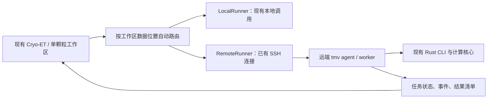

# SSH 远程处理设计与实施记录

## 默认行为

用户不需要在每个步骤重复选择本地或服务器。

- SSH 插件启用、连接有效，且工作区的数据来自该 SSH 目录：Cryo-ET、单颗粒、CTF、去噪和 STA 自动使用同一服务器。
- 本地打开的数据：默认本地处理。仅安装插件、打开连接窗口或后台存在其他 SSH 连接，不改变本地工作区。
- 已打开的远程项目断线：保留远程项目和任务身份，提示重连。不能把 `ssh:…` 交给本地文件系统，也不能静默下载整批原始数据后在本地重跑。
- 已提交任务的运行位置固定。关闭窗口或断线不等于取消任务；取消是独立操作。

工作区顶部常驻一行：`运行位置：amax · SSH · 2 × RTX 3090`，并显示真实输入目录、输出位置和连接状态。按钮仍叫“开始”，提交后叫“正在服务器上运行”。本地工作区显示“运行位置：本机”。

## 已核实的基础与缺口

当前 `src-tauri/src/cli.rs` 已有 `tomo`（也接受目录）、`spa`、`ctf`、`sta`、`denoise`、`info`，复用桌面的处理代码。结果是 stdout JSON，并写入项目的结果 JSON；进度目前是 stderr 文本。STA 可返回 `needsChoice` 和候选卡片，退出码 2 表示等用户选择，不能当作失败。

已检查的历史 CLI 发布包约 52 MiB；amax 现有测试二进制约 165 MiB。它不是约 5 MB 的静态缩略图工具。现有打包流程包含 CUDA libdevice；运行仍需匹配 Linux 架构、glibc/libstdc++、GPU 驱动，某些功能还需要模型文件。不能承诺复制单个二进制即可覆盖所有机器和所有功能。

当前截图的直接原因是工作区把 `S.folder.dir` 中的虚拟 SSH 标识传给本地 `tomo_session`。另一个独立缺口是 `tomo::session::scan` 只扫描根目录直接包含的 MDOC；`eer/ + mdocfolder/ + gain` 这种真实结构，即使改成远端执行，也仍需扫描器支持。

尚未核实或尚不存在的完整能力：版本化 RPC 协议、机器可读进度事件、跨连接任务登记/重连、统一取消和恢复契约、每项能力的探测结果。这些属于实施内容，不能把现有文本日志解析当作完成。

## 结构



`WorkspaceLocation` 是结构化数据，而不是伪装成本地路径的字符串：

```ts
type WorkspaceLocation =
  | { kind: 'local'; path: string }
  | { kind: 'ssh'; connectionId: string; hostFingerprint: string; path: string };
```

只有 Runner 处理传输和执行位置。算法模块接收服务器上真实存在的路径，不了解 SSH URL。不同标签页/工作区保留自己的位置；切换连接不能把旧项目误发给新服务器。

Runner 的公共操作是 `inspect / submit / events / status / cancel / artifacts`。两种 Runner 返回同一种任务状态与结果模型，工作区不用复制两套 UI。

## 首次使用与引擎准备

1. 通过现有已验证的 SSH 会话探测 Linux/架构、运行库、可用 GPU/显存、磁盘空间、数据可读性和输出位置可写性。
2. 优先复用对应版本且校验通过的远端引擎；缺少时由 App 经 SFTP 上传匹配的 CLI 包。版本、平台和包摘要构成缓存身份；先写临时位置，完整校验后再原子切换。
3. 放在远端用户缓存，例如 `~/.cache/tifmrcview/engines/<platform>/<sha>/`，无 root、无系统安装、无对外监听端口。不要求 Python、tmux 或远端访问互联网。
4. GPU 驱动无法随 CLI 解决。缺少驱动、模型或所需运行库时，明确列出缺口；能用 CPU 的步骤可以提供 CPU 选项，不能把能力缺失冒充为排队。
5. 模型只在用到该功能时检查，优先复用已有文件或由用户指定。不在后台自动拉取大量权重；遵守现有网络流量确认约束。
6. 正在运行的任务固定使用其引擎版本；App 更新只影响新任务，不覆盖旧任务使用的文件。

## 数据发现与输入契约

先做轻量元数据扫描，不解码或传回整批 EER。

- 共享一个采集目录扫描器供本地工作区、远端 agent 和 CLI 使用。
- 在有边界的目录深度内发现 MDOC、EER/TIFF 电影、gain 与已处理结果；允许 `mdocfolder`、`eer` 改名，不依赖固定目录名。
- 解析 MDOC 的 SubFramePath，处理 Windows 历史路径、重定位和相对路径；以明确映射与唯一匹配为准。多个同名文件、多个 gain 或尺寸不匹配需显示待确认项，不能随意选第一个。
- 界面先展示识别结果：97 个倾转序列、5709 个电影、匹配/缺失/歧义数、gain、输出目录和处理范围，再由既有“开始”按钮提交。
- `.gain` 的 TIFF/MRC 表示与校正含义必须在计算核心中统一判断。预览原始计数与应用 gain 是不同动作，不能因为文件齐全就宣称处理正确。

任务请求包含原始输入根目录、解析后的关联映射、用户选择、目的、参数、输出位置、引擎版本和客户端请求 ID。原始采集数据保持只读。处理输出和任务控制文件分别管理；输出目录参数须贯通 CLI 与核心，不能仅给外层 shell 换一个工作目录。

## 任务生命周期与断线恢复

- 在同一 `tmv` 分发包中增加受限 agent/job 模式，使用版本化 JSON 请求；不拼接任意用户命令，不把密码或密钥传给服务器进程。
- SSH 通道负责控制；worker 在独立进程会话中运行，状态与日志持久化到任务目录。无需常驻系统服务。
- 客户端请求 ID 幂等：提交响应丢失后查询同一个 ID，不能直接再启动一份。
- 状态至少有：准备中、排队、运行、等待用户选择、完成、失败、取消中、已取消；“连接断开”是观察通道状态，不等于计算失败。
- 事件是带递增序号的 JSONL，包含阶段、已完成/总量、消息和结果增量。重连携带事件游标，只补读缺失部分；普通 stderr 另作诊断日志。
- 取消只作用于该 job 的进程组，并校验任务 ID、进程启动身份与引擎路径；先协作取消，再有限等待，不能按进程名批量 kill。无安全检查点的步骤中断后显示“需重跑当前步骤”，不能假装支持恢复。
- 首版同一项目独占、共享 GPU 排队；先接已有核心的资源锁。多 GPU 与集群调度留作后续能力，不因机器有两张卡就默认抢占全部资源。
- STA/分类等需要人工选择时回传候选卡片并进入“等待选择”；选择后继续同一远端工作流，不擅自选类。

## 结果体验

结果首先保存在服务器项目输出位置。默认回传状态、JSON 元数据、二维预览和小型结果清单；三维体/叠层复用 SSH 按需缓存，在用户打开时读取。任务完成不自动下载整套原始电影或所有中间结果。

结果清单记录服务器身份、远端路径、类型、大小、mtime/摘要、关联任务和状态。工作区可直接显示序列/分类卡片、排除项、CTF/运动校正诊断和重构预览；“下载结果…”是独立的显式操作，完成后标明本地副本来源。

## 实施顺序与验收

1. **位置与发现**：修正虚拟路径边界，建立共享扫描器和结果/任务模型；本地默认行为回归通过。
2. **远端纵向闭环**：引擎预检/上传、单任务幂等提交、结构化进度、取消、重连。先接 Cryo-ET survey，再接正式重构；在用户授权的一个真实序列上验收，不自动启动全部 97 个序列。
3. **单颗粒/CTF**：复用 Runner 与任务面板，回传二维分类卡片和诊断，再接后续选类与精修阶段。
4. **STA/去噪与交互续跑**：映射已有 CLI 目的和用户选择，补齐必要协议。

每阶段分别验证：CLI 命令层、真实 SSH 生命周期、原生 App 操作和实际数据输出。最低验收包括断线/重启 App 后找回任务、提交响应丢失不重复启动、取消仅命中本任务、输出未损坏、无原始电影批量回传、本地数据仍在本地处理。图像生成或任务完成本身不构成科学有效性验证。

## 参考实践

- [VS Code Remote SSH](https://code.visualstudio.com/docs/remote/ssh)：客户端自动准备并维护远端引擎；可由本地下载后转传，不要求远端具备同样的桌面环境。本方案复用这个部署方式，增加科学计算任务的持久化与资源约束。
- [CryoSPARC 任务状态](https://guide.cryosparc.com/application-guide/managing-jobs)和[交互式任务](https://guide.cryosparc.com/application-guide/inspecting-job-data)：计算任务与连接分离，等待用户选择是一等状态。本方案借鉴状态语义，不引入其服务栈或 Python 依赖。
- [SerialEM MDOC](https://bio3d.colorado.edu/SerialEM/stableHlp/html/about_formats.htm)、[IMOD alignframes](https://bio3d.colorado.edu/imod/doc/man/alignframes.html)：采集记录与电影路径可以独立搬迁，不能把目录名固定成协议。

## 本次实施记录（2026-11-16）

授权：先 Cryo-ET，再单颗粒，在 amax 实测并更新本地 App。
工作分支 codex/ssh-processing-20261116，基于 main 1e457ac；原始脏工作区不动。
验收：远程目录自动路由、本地不变；引擎上传校验；真实采集目录发现；单序列 survey/重构及 SPA 实际计算；进度、取消、幂等与断线恢复；结果按需打开；正式签名 App computer use。
原始数据只读，计算输出保存在服务器独立项目缓存，用户选择决定处理范围。不得自动跑全部 97 个序列，不下载模型。
当前：独立工作区已建立，amax LAN 连通，GPU 有其他进程，复用 GPU 资源锁。

用户补充：递归检索所选目录内所有 MDOC，按记录的文件名匹配电影，不依赖记录中的旧地址或固定文件夹名；电影不限 EER。
已实施：共享递归采集索引（循环链接去重、缺失/重名/权限问题报告）、EER/TIFF/MRC 等通过现有读取器处理；传递本机启用的格式模块；增益变化使运动校正缓存失效。
已实施：版本化 agent、持久化 worker、幂等提交、结构化进度、项目独占与 GPU 锁、协作取消、独立输出位置与空间预估、工作区自动路由及按需打开结果；发布打包携带 Linux 引擎。
已验证：原始目录发现 97 组；104 组可匹配 60/61 电影，缺失 Falcon4i_02110.eer。第一轮真实 EER survey 完成，缺失/未知剂量记录保留；此轮未找到根目录 gain，不能作为最终校正验收。新增递归增益发现后的复核正在准备。
已验证：每次查询断开 SSH 后 worker 持续；重复提交复用同一 ID，参数重绑被拒绝；排队任务取消不影响另一个任务。7 项路由测试、SSH 浏览器夹具通过；多层目录的 MRC/TIFF 实际运动校正及 gain 变化重新计算测试通过。
后续实测：104 组以递归找到的 gain 完成再次运动校正、对齐和快速重构，结果为 1024×1024×296 的浮点 MRC；缺失电影与未知剂量提示保留。3 个真实 EMPIAR-10025 TIFF 电影完成运动校正、CTF 与颗粒发现，回传 3 类卡片并停在等待用户选择，未擅自选择生物学类别。
后续实测：amax 上将 60 个真实 EER 分散到多层目录、MDOC 放入另一棵深目录并保留旧地址、gain 放到校准目录，全部正确检索；循环目录链接不会重复计数。
补充任务恢复：请求已保存但控制进程尚未启动 worker 时可重试恢复；并发重试及延迟启动的重复 worker 受任务锁和状态检查保护，不会重跑已完成任务。实测脚本为 scripts/test-ssh-processing.py。
Linux 引擎封装完成；首轮正式签名 Pro App 已通过 SSH 连接、97 组检索、对齐/断层预览和主窗口打开。用户验收补充：小窗预览改为首帧立即可用、按需缓冲、明确加载/失败/重试；任务状态优先于预览请求，显示阶段和实际计数，修复浅色文字与增益路径显示。8 项路由测试和真实预览组件的延迟/失败夹具通过。剩余：最终 UI 补丁的正式签名双版本 App 更新与 computer use 复核。验收记录保存在 /Volumes/samsung/tifview-build.noindex/ssh-processing-20261116/。
范围：先接 Cryo-ET 文件夹流程和 SPA 工作区；STA/独立去噪等其他工作区尚未接远端。远端 SPA 使用内置挑选，不上传可选 SAM 模型，不下载模型。
保留限制：非检查点中断须重跑当前步骤，协作取消不能保证立即打断驱动调用。随包引擎目前支持 Linux x86_64。递归最多 64 层、一百万项，超限明确报错，不静默漏扫；不可读目录列出警告。

## GPU 与多卡续作（2026-11-16）
用户明确授权：可加速步骤接 GPU；逐步骤展示实际 CPU/GPU/设备，CPU 回退展示原因；多 GPU 服务器使用全部允许设备；amax 实测后更新本地 App。
基线 main 12ae043；独立工作区 codex/ssh-gpu-20261116。原有 denoise 和 linux-control 脏工作区保留，只读参考，不吸收其未提交代码。
验收：运动校正（含快速预览）、CTF、倾转对齐、重构、反卷积有实际后端证据；与 CPU 数值参考比较；双 3090 的实际进程/显存/任务分配可验证；单卡/无 GPU/内核失败有明确原因与安全回退；重连、取消和预览不回归；正式签名本地 App CUA。
方案：现有 Burn 原生 FFT 与 GPU 内核优先；分批 3D FFT 控制显存。隔离子进程按 UUID 调度不同序列，单序列的电影可分批至各卡；单个非并行阶段不强求同时占满全部卡。设备掩码和其他用户进程保持不变。
参考 NVIDIA CUDA_VISIBLE_DEVICES、Dask-CUDA worker_count、RELION MotionCorrection：进程绑定设备/独立输入分工得到支持；与 cuFFT 单体多卡 FFT 不同，本项目复用现有 Burn 内核，不引入额外 CUDA 库或网络依赖。
步骤：1 后端事件与 GPU 核心补齐；2 隔离 worker/多卡队列；3 amax 数值、真实数据与回退测试；4 界面逐卡阶段与原因；5 打包、CUA、验收记录与工作区收尾。
状态：完成只读梳理；amax LAN 连通，GPU0 现有约6 GB占用、GPU1空闲，未改变其他进程。尚未实施。
阶段记录：初版实现 GPU 原生 CTF FFT、运动预览三次插值、分批 GPU 反卷积、实际后端事件、CPU回退原因与资源面板。amax 5项GPU数值测试通过（含反卷积、预览、求和、重构），CTF 3项通过；浏览器资源/回退夹具通过。
初版双序列真实任务 0481e239... 已在两张 3090 上记录运动FFT、预览求和、快速CTF；进一步发现 CPU 迭代相关仍耗时，故协作取消本任务（已确认 cancelled，非用户 Nav9），补充 GPU 批量参考叠加/相关/亚像素搜索。该新求解器增加每电影两帧 CPU 搜索校准，超差回退；movie 位移比较必须去掉任意公共平移规范，既有校准容差 0.05px。最终数值与真实数据验收仍待完成，不能把初版物理GPU占用视作全流程通过。
实现中的资源约束：读取 CPU 可用线程、MemAvailable、各卡 UUID/可见性/可用显存/利用率、输出路径所在文件系统空间；GPU worker 至少2GB可用显存，内存按16GB/worker的保守预算限制并发。保留数字卡号与旧默认锁兼容；父调度器延迟锁定，避免父子互等。
本次证据目录 /Volumes/samsung/tifview-build.noindex/ssh-gpu-20261116；amax 源 /mnt/sdd/code/tmv-ssh-gpu-20261116/src-tauri，构建 source /mnt/sdd/code/tmv-linux-20261113/build-env.sh（离线缓存、CARGO_TARGET_DIR=/mnt/sdd/code/tmv-test/target）。不可变试验引擎 draft-engine-v1 已停止任务；新构建日志 solver-gpu-tests2.log/build3.log。尚未提交、打包或更新 App。
用户环境变更：局域网测试机现为 leehow-pc Linux，amax-lan 已不可达；保留 amax 试验任务 e088877f...，最后确认在两卡运动阶段（约7/61），不可声称完整双卡验收通过。后续改在 192.168.31.113 / leehow-pc.local（用户 leehow）单 RTX5080 16GB、64GB RAM 实测；不改 MinerU/SSH/网络服务。源与私有 Cargo 缓存经 LAN 放在 /home/leehow/leehow/code/tmv-ssh-gpu-20261116，离线 Rust1.99.1 借用只读 /home/leehow/w10-scratch/rustup/toolchains/1.99.1-x86_64-unknown-linux-gnu。CARGO_BUILD_JOBS=4，自己的 target/cargo；无 Internet 下载。
新增实际耗时诊断：4K 预览移位的 CPU 索引生成耗时约68秒/电影，已改为 GPU arange/整数索引生成，保持同样三次插值，待 5080 数值与耗时复核。NVRTC12.8.93 运行库在 leehow-pc MinerU虚拟环境的 nvidia/cuda_nvrtc/lib，可只读复用随引擎携带；确保不依赖服务器Python环境，保留 NVIDIA 原始许可。不更改现有虚拟环境。

更正下载记录：首次离线构建的 LLVM bundler 仍尝试下载约13MB，已停止自己的构建进程；核对官方大小后补齐45.4MB LLVM归档并校验SHA256。后续使用已验证缓存并关闭构建脚本的校验和网络查询，无模型下载。
leehow-pc 验证进展：Vulkan 7项及 CUDA 7项数值/共享摘要测试通过；CUDA预览最大误差3.8e-6、反卷积相对RMS2.24e-7，WBP/SIRT/SART相对L2均小于4e-7。电影迭代位移去公共平移后最大差0.0436px（容差0.05px）。最新4K基准、CTF、真实数据和App尚待验收。资源/逐卡状态/回退提示/持久历史浏览器夹具通过，路由及发布说明11项通过。新机器已有Nav110 raw54.st及54个真实角度，只读符号链接到本任务输入目录；真实EER从Mac缓存通过LAN复制，没有重复模拟为多张倾转电影。

用户追加性能原则：合批并让中间结果驻留GPU，含传输的实际耗时不占优时使用CPU。4K四帧初版测试CPU149ms、GPU486ms，因此预览增加4M像素批次、GPU驻留中间值、每输入形状一次CPU/GPU端到端校准；局部相关和倾转追踪保留含传输的耗时选择。反卷积改为完整3D FFT/滤波驻留GPU，显存预算不足则明确回退CPU，避免六次分轴往返。预览跨批次偶奇半集及自动选择测试通过，最新驻留反卷积待数值验证。
真实Nav110 54张图已完成候选引擎的对齐、CTF、SART重构、反卷积，残差1.57px，输出1024级断层图，计算设备事件均保留。真实Falcon4i_01963.eer及实际gain完成40组运动预览，解码5.57秒、对齐1.38秒、求和0.143秒；后续性能策略修改须重新验证，不能沿用此前验收。Nav110输入首次符号链接被扫描器归一化后找不到旁边角度文件，未进行处理；后改为本任务独立副本（原始数据未改），再完成真实任务。
兼容构建：leehow-pc为Ubuntu26.04/glibc2.43，直接编译不满足引擎原有glibc2.34基线。仅提取官方小型glibc2.34链接SDK及兼容C++/GCC库到任务目录，不安装或替换系统库；重链接及旧加载器检查尚待通过。


## 2026-11-16 SSH GPU 吞吐优化续做

目标：以 SSH 服务器上完整 Cryo-ET / 单颗粒任务耗时为准，减少主机与 GPU 数据往返、重复 DFT 和调度开销；沿用现有自动远程路由、真实设备/原因报告、恢复与取消契约。
当前基线 main 78226b7，独立工作区 codex/ssh-throughput-20261116；原工作目录的去噪等修改不属于本任务。
验收：相同输入下先测基线，再测优化；批量相关对 CPU 位移误差 <0.05 px、CC 误差 <0.01；真实 Nav110 与真实 EER 的 SSH 全流程完成，保留耗时和实际后端记录。现 LAN 主机 leehow-pc RTX5080 一卡，多卡完整硬件验收仍未完成。
候选实现：相关改用原生批量 FFT，频谱与细化搜索驻留 GPU，仅回传峰值及小网格；电影迭代相位在 GPU 生成，避免每轮传入整幅相位阵列。先测批量相关，未证明有效前不扩展到其他算法。
参考：NVIDIA CUDA Best Practices（减少传输、合批、驻留）https://docs.nvidia.com/cuda/cuda-c-best-practices-guide/；PyTorch fft2（沿最后二维批量 FFT）https://docs.pytorch.org/docs/stable/generated/torch.fft.fft2.html。确认批量 FFT 是成熟路径；不引入 Python/新运行时，复用 Burn 原生 FFT。最终仍以本项目数值和端到端实测为准。
证据目录：/Volumes/samsung/tifview-build.noindex/ssh-throughput-20261116。
状态：新增基线数值/吞吐测试，准备在已有离线缓存上运行；尚未实现或发布本轮优化。


阶段实测：批量相关 CUDA 数值（32/64/128/256边长）通过，电影位移差0.04352px低于0.05px，12项运动校正测试通过。64个256²patch的GPU中位耗时39.30ms→17.70ms（3轮），128²为19.50ms→9.18ms；包含数据传输和结果读取。首轮整任务对照并未改善总耗时：ROI 67.69s→70.28s，单颗粒运动17.94s→17.83s，因此不能把核函数提速当作任务加速。
继续定位ROI约49s耗在轴角候选搜索；改为最多4个独立候选共享现有Rayon池，无新增线程池/栈副本，按输入顺序收集后仍使用原有0.9择优/镜像规则。显示候选数和实际并行度，手动单轴仍保留逐图进度。官方Rayon IndexedParallelIterator文档确认有序collect及嵌套共享池 https://docs.rs/rayon/latest/rayon/iter/trait.IndexedParallelIterator.html 。三候选串并行phantom几何/残差及单调进度测试通过；最终真实耗时仍待下一轮。
扩大gpu过滤器曾包含未修改的nad_eed_gpu硬件自检，CUDA数值自检失败；未证明该失败是否也发生于基线，不作“已存在”推断，不修改本任务之外的NAD代码。完整扩大套件不能称通过；仅上述定向套件通过。该记录与主线Cryo-ET/运动校正数值验收分开。


本轮最终CLI实测：相同Nav110 ROI的54张倾转图，倾转对齐49.52s→23.17s；整自动流程67.69s→41.94s。注意实际后端数值路线使拟合轴从5.2°变为5.0°，自动厚度从184层变为168层，因此整任务数字不能当作固定尺寸重构的加速比，也不能用残差降低证明科学准确性。三组ROI及五个单颗粒运动结果均检查文件长度、有限像素及有效强度范围。GPU批量相关、电影位移、运动校正、并行候选几何/进度定向测试通过。CTF、重构、反卷积在实际日志中使用GPU；候选几何拟合显示CPU及并行度。
单颗粒冷启动两次：基线运动17.94/20.64s，新版22.92/17.34s；波动较大，不能宣称稳定的整任务提速。保留全部初版/改进版/重复测试，避免只选最快一次。只在一张RTX5080上完成硬件验证，双GPU完整流程仍未验证。
最后交付采用0.7.217，桌面与引擎固定源码摘要；安装、Computer Use、main集成及工作区关闭的最终状态由证据目录acceptance.json及安装收据记录。源码记录本身不替代这几个完成门槛。原始数据、服务、SSH/网络配置不修改；不下载模型，不发布GitHub更新。


## 2026-11-16 本地 Metal 完整验收

用户批准范围：Mac统一内存预算、每步实际CPU/GPU及原因、NAD Metal数值、本机M1 Max真实Cryo-ET/单颗粒流程；通过后合并main、打包更新规范App路径并Computer Use。此机32GiB统一内存、10CPU核、M1 Max 32GPU核。基线4ae45bc；当前独立工作区codex/local-metal-20261116，保留主目录所有未提交修改。
执行：先运行能暴露NVIDIA-only 512MiB预算的实际Metal反卷积测试，以及既有NAD硬件参考测试；再形成假设/最小修复；实际设备事件须覆盖本地任务且不混入SSH工作区。真实数据复用已缓存的Nav110 ROI.st、EER及gain；补齐真实rawtlt关联，原始数据只读，不下载模型、不修改服务器服务。执行和安装证据保存在/Volumes/samsung/tifview-build.noindex/local-metal-20261116；未通过门槛不称完成。


本地 Metal 当前验证：修复前 256³ 实际反卷积因错误 512 MiB 预算失败；修复后通过（768 MiB 估计工作区）。使用 MTLDevice 推荐工作集减当前分配、Mach free+inactive 可回收内存减 2 GiB 系统预留及单缓冲限制的较小值；NAD 统一内存同时计入 CPU 张量工作区。macOS 的 os_proc_available_memory 不可用，未采用该 iOS API。
参考：Apple MTLDevice recommendedMaxWorkingSetSize/currentAllocatedSize 文档；llama.cpp ggml-metal-device.m 的实际设备查询。前者确认建议工作集为性能上限，后者确认成熟实现直接查询设备而非套用离散显卡探测；本实现另加当前系统内存约束，不复制代码。
NAD 现有 Metal 18 组原始参考体迭代均 maxdelta=0；未放松任何数值资格阈值。CPU f64 张量/特征分解保留，GPU 负责三维扩散。真实 EMPIAR-10164 的 41 个电影与原始 mdoc 完成 motion→CTF→alignment→SART full/even/odd→Noise2Noise→deconv，312 s 结束、ok=true。缺失楔试跑 20 步后预计需 1.2 h，按原有自动预算跳过并返回说明；mdoc 缺少有效剂量，保留未加剂量权重警告。该计时与低并发编译有重叠，不作性能基准。T20S 48 张微图仍待完整重跑。所有输入只读链接，输出在证据目录；不是生物学质量或分辨率验证。
本地任务通过独立 computeId + scoped context 发实际后端，传播 shared Rayon 与 GPU worker 线程，独立去重；前端只包装路由后的 native 调用。UI fixture 已确认并发任务隔离、回退原因/toast/历史、details 展开状态、新任务清空和 SSH 隔离；既有 remote routing 12 项与资源 UI fixture、denoise UI/Metal completion 18 项通过。剩余：最新源码硬件复验、真实 SPA、桌面 Pro/Basic 编译、main 集成、签名安装与 CUA。

冻结前复核：补上 NAD 资格检查的瞬态失败重试，只缓存数值检查成功；新增失败→恢复→成功缓存回归测试通过。没有修改 NAD 扩散数值或放松检查。UI 常显当前实际设备，全部步骤历史默认收起，保留用户展开状态，避免挤掉小面板中的操作控件；更新后的 fixture 通过。Pro 和基础版最终 cargo check 均通过。当前真实 SPA 已通过二维分类、初始模型并进入三维精修，最终 Cryo-ET 冷重跑按 GPU 租约排队。真实流程 runner 的编译快照保留在 cli-validated-source-files.json；后加变化仅为未在这两个默认流程中调用的 NAD 资格缓存和前端展示，NAD 独立真实体及参考体会用最终源码重验。
本轮唯一执行计划的动态验收状态及最终安装/CUA/源码证明继续写入 `/Volumes/samsung/tifview-build.noindex/local-metal-20261116/acceptance.json`，与本节共同构成本轮计划；冻结后不修改构建源码来记进度。main 集成、安装和 CUA 必须等真实流程及最终 NAD 复验通过。SSH Linux 引擎保持 0.7.217 的既有独立包，记录其来源提交与哈希，不声称本次重编译 Linux 引擎。
