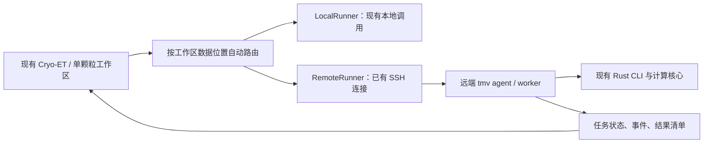

# SSH 远程处理设计与实施记录

## 默认行为

用户不需要在每个步骤重复选择本地或服务器。

- SSH 插件启用、连接有效，且工作区的数据来自该 SSH 目录：Cryo-ET、单颗粒、CTF、去噪和 STA 自动使用同一服务器。
- 本地打开的数据：默认本地处理。仅安装插件、打开连接窗口或后台存在其他 SSH 连接，不改变本地工作区。
- 已打开的远程项目断线：保留远程项目和任务身份，提示重连。不能把 `ssh:…` 交给本地文件系统，也不能静默下载整批原始数据后在本地重跑。
- 已提交任务的运行位置固定。关闭窗口或断线不等于取消任务；取消是独立操作。

工作区顶部常驻一行：`运行位置：amax · SSH · 2 × RTX 3090`，并显示真实输入目录、输出位置和连接状态。按钮仍叫“开始”，提交后叫“正在服务器上运行”。本地工作区显示“运行位置：本机”。

## 已核实的基础与缺口

当前 `src-tauri/src/cli.rs` 已有 `tomo`（也接受目录）、`spa`、`ctf`、`sta`、`denoise`、`info`，复用桌面的处理代码。结果是 stdout JSON，并写入项目的结果 JSON；进度目前是 stderr 文本。STA 可返回 `needsChoice` 和候选卡片，退出码 2 表示等用户选择，不能当作失败。

已检查的历史 CLI 发布包约 52 MiB；amax 现有测试二进制约 165 MiB。它不是约 5 MB 的静态缩略图工具。现有打包流程包含 CUDA libdevice；运行仍需匹配 Linux 架构、glibc/libstdc++、GPU 驱动，某些功能还需要模型文件。不能承诺复制单个二进制即可覆盖所有机器和所有功能。

当前截图的直接原因是工作区把 `S.folder.dir` 中的虚拟 SSH 标识传给本地 `tomo_session`。另一个独立缺口是 `tomo::session::scan` 只扫描根目录直接包含的 MDOC；`eer/ + mdocfolder/ + gain` 这种真实结构，即使改成远端执行，也仍需扫描器支持。

尚未核实或尚不存在的完整能力：版本化 RPC 协议、机器可读进度事件、跨连接任务登记/重连、统一取消和恢复契约、每项能力的探测结果。这些属于实施内容，不能把现有文本日志解析当作完成。

## 结构



`WorkspaceLocation` 是结构化数据，而不是伪装成本地路径的字符串：

```ts
type WorkspaceLocation =
  | { kind: 'local'; path: string }
  | { kind: 'ssh'; connectionId: string; hostFingerprint: string; path: string };
```

只有 Runner 处理传输和执行位置。算法模块接收服务器上真实存在的路径，不了解 SSH URL。不同标签页/工作区保留自己的位置；切换连接不能把旧项目误发给新服务器。

Runner 的公共操作是 `inspect / submit / events / status / cancel / artifacts`。两种 Runner 返回同一种任务状态与结果模型，工作区不用复制两套 UI。

## 首次使用与引擎准备

1. 通过现有已验证的 SSH 会话探测 Linux/架构、运行库、可用 GPU/显存、磁盘空间、数据可读性和输出位置可写性。
2. 优先复用对应版本且校验通过的远端引擎；缺少时由 App 经 SFTP 上传匹配的 CLI 包。版本、平台和包摘要构成缓存身份；先写临时位置，完整校验后再原子切换。
3. 放在远端用户缓存，例如 `~/.cache/tifmrcview/engines/<platform>/<sha>/`，无 root、无系统安装、无对外监听端口。不要求 Python、tmux 或远端访问互联网。
4. GPU 驱动无法随 CLI 解决。缺少驱动、模型或所需运行库时，明确列出缺口；能用 CPU 的步骤可以提供 CPU 选项，不能把能力缺失冒充为排队。
5. 模型只在用到该功能时检查，优先复用已有文件或由用户指定。不在后台自动拉取大量权重；遵守现有网络流量确认约束。
6. 正在运行的任务固定使用其引擎版本；App 更新只影响新任务，不覆盖旧任务使用的文件。

## 数据发现与输入契约

先做轻量元数据扫描，不解码或传回整批 EER。

- 共享一个采集目录扫描器供本地工作区、远端 agent 和 CLI 使用。
- 在有边界的目录深度内发现 MDOC、EER/TIFF 电影、gain 与已处理结果；允许 `mdocfolder`、`eer` 改名，不依赖固定目录名。
- 解析 MDOC 的 SubFramePath，处理 Windows 历史路径、重定位和相对路径；以明确映射与唯一匹配为准。多个同名文件、多个 gain 或尺寸不匹配需显示待确认项，不能随意选第一个。
- 界面先展示识别结果：97 个倾转序列、5709 个电影、匹配/缺失/歧义数、gain、输出目录和处理范围，再由既有“开始”按钮提交。
- `.gain` 的 TIFF/MRC 表示与校正含义必须在计算核心中统一判断。预览原始计数与应用 gain 是不同动作，不能因为文件齐全就宣称处理正确。

任务请求包含原始输入根目录、解析后的关联映射、用户选择、目的、参数、输出位置、引擎版本和客户端请求 ID。原始采集数据保持只读。处理输出和任务控制文件分别管理；输出目录参数须贯通 CLI 与核心，不能仅给外层 shell 换一个工作目录。

## 任务生命周期与断线恢复

- 在同一 `tmv` 分发包中增加受限 agent/job 模式，使用版本化 JSON 请求；不拼接任意用户命令，不把密码或密钥传给服务器进程。
- SSH 通道负责控制；worker 在独立进程会话中运行，状态与日志持久化到任务目录。无需常驻系统服务。
- 客户端请求 ID 幂等：提交响应丢失后查询同一个 ID，不能直接再启动一份。
- 状态至少有：准备中、排队、运行、等待用户选择、完成、失败、取消中、已取消；“连接断开”是观察通道状态，不等于计算失败。
- 事件是带递增序号的 JSONL，包含阶段、已完成/总量、消息和结果增量。重连携带事件游标，只补读缺失部分；普通 stderr 另作诊断日志。
- 取消只作用于该 job 的进程组，并校验任务 ID、进程启动身份与引擎路径；先协作取消，再有限等待，不能按进程名批量 kill。无安全检查点的步骤中断后显示“需重跑当前步骤”，不能假装支持恢复。
- 首版同一项目独占、共享 GPU 排队；先接已有核心的资源锁。多 GPU 与集群调度留作后续能力，不因机器有两张卡就默认抢占全部资源。
- STA/分类等需要人工选择时回传候选卡片并进入“等待选择”；选择后继续同一远端工作流，不擅自选类。

## 结果体验

结果首先保存在服务器项目输出位置。默认回传状态、JSON 元数据、二维预览和小型结果清单；三维体/叠层复用 SSH 按需缓存，在用户打开时读取。任务完成不自动下载整套原始电影或所有中间结果。

结果清单记录服务器身份、远端路径、类型、大小、mtime/摘要、关联任务和状态。工作区可直接显示序列/分类卡片、排除项、CTF/运动校正诊断和重构预览；“下载结果…”是独立的显式操作，完成后标明本地副本来源。

## 实施顺序与验收

1. **位置与发现**：修正虚拟路径边界，建立共享扫描器和结果/任务模型；本地默认行为回归通过。
2. **远端纵向闭环**：引擎预检/上传、单任务幂等提交、结构化进度、取消、重连。先接 Cryo-ET survey，再接正式重构；在用户授权的一个真实序列上验收，不自动启动全部 97 个序列。
3. **单颗粒/CTF**：复用 Runner 与任务面板，回传二维分类卡片和诊断，再接后续选类与精修阶段。
4. **STA/去噪与交互续跑**：映射已有 CLI 目的和用户选择，补齐必要协议。

每阶段分别验证：CLI 命令层、真实 SSH 生命周期、原生 App 操作和实际数据输出。最低验收包括断线/重启 App 后找回任务、提交响应丢失不重复启动、取消仅命中本任务、输出未损坏、无原始电影批量回传、本地数据仍在本地处理。图像生成或任务完成本身不构成科学有效性验证。

## 参考实践

- [VS Code Remote SSH](https://code.visualstudio.com/docs/remote/ssh)：客户端自动准备并维护远端引擎；可由本地下载后转传，不要求远端具备同样的桌面环境。本方案复用这个部署方式，增加科学计算任务的持久化与资源约束。
- [CryoSPARC 任务状态](https://guide.cryosparc.com/application-guide/managing-jobs)和[交互式任务](https://guide.cryosparc.com/application-guide/inspecting-job-data)：计算任务与连接分离，等待用户选择是一等状态。本方案借鉴状态语义，不引入其服务栈或 Python 依赖。
- [SerialEM MDOC](https://bio3d.colorado.edu/SerialEM/stableHlp/html/about_formats.htm)、[IMOD alignframes](https://bio3d.colorado.edu/imod/doc/man/alignframes.html)：采集记录与电影路径可以独立搬迁，不能把目录名固定成协议。

## 本次实施记录（2026-11-16）

授权：先 Cryo-ET，再单颗粒，在 amax 实测并更新本地 App。
工作分支 codex/ssh-processing-20261116，基于 main 1e457ac；原始脏工作区不动。
验收：远程目录自动路由、本地不变；引擎上传校验；真实采集目录发现；单序列 survey/重构及 SPA 实际计算；进度、取消、幂等与断线恢复；结果按需打开；正式签名 App computer use。
原始数据只读，计算输出保存在服务器独立项目缓存，用户选择决定处理范围。不得自动跑全部 97 个序列，不下载模型。
当前：独立工作区已建立，amax LAN 连通，GPU 有其他进程，复用 GPU 资源锁。

用户补充：递归检索所选目录内所有 MDOC，按记录的文件名匹配电影，不依赖记录中的旧地址或固定文件夹名；电影不限 EER。
已实施：共享递归采集索引（循环链接去重、缺失/重名/权限问题报告）、EER/TIFF/MRC 等通过现有读取器处理；传递本机启用的格式模块；增益变化使运动校正缓存失效。
已实施：版本化 agent、持久化 worker、幂等提交、结构化进度、项目独占与 GPU 锁、协作取消、独立输出位置与空间预估、工作区自动路由及按需打开结果；发布打包携带 Linux 引擎。
已验证：原始目录发现 97 组；104 组可匹配 60/61 电影，缺失 Falcon4i_02110.eer。第一轮真实 EER survey 完成，缺失/未知剂量记录保留；此轮未找到根目录 gain，不能作为最终校正验收。新增递归增益发现后的复核正在准备。
已验证：每次查询断开 SSH 后 worker 持续；重复提交复用同一 ID，参数重绑被拒绝；排队任务取消不影响另一个任务。7 项路由测试、SSH 浏览器夹具通过；多层目录的 MRC/TIFF 实际运动校正及 gain 变化重新计算测试通过。
后续实测：104 组以递归找到的 gain 完成再次运动校正、对齐和快速重构，结果为 1024×1024×296 的浮点 MRC；缺失电影与未知剂量提示保留。3 个真实 EMPIAR-10025 TIFF 电影完成运动校正、CTF 与颗粒发现，回传 3 类卡片并停在等待用户选择，未擅自选择生物学类别。
后续实测：amax 上将 60 个真实 EER 分散到多层目录、MDOC 放入另一棵深目录并保留旧地址、gain 放到校准目录，全部正确检索；循环目录链接不会重复计数。
补充任务恢复：请求已保存但控制进程尚未启动 worker 时可重试恢复；并发重试及延迟启动的重复 worker 受任务锁和状态检查保护，不会重跑已完成任务。实测脚本为 scripts/test-ssh-processing.py。
Linux 引擎封装完成；首轮正式签名 Pro App 已通过 SSH 连接、97 组检索、对齐/断层预览和主窗口打开。用户验收补充：小窗预览改为首帧立即可用、按需缓冲、明确加载/失败/重试；任务状态优先于预览请求，显示阶段和实际计数，修复浅色文字与增益路径显示。8 项路由测试和真实预览组件的延迟/失败夹具通过。剩余：最终 UI 补丁的正式签名双版本 App 更新与 computer use 复核。验收记录保存在 /Volumes/samsung/tifview-build.noindex/ssh-processing-20261116/。
范围：先接 Cryo-ET 文件夹流程和 SPA 工作区；STA/独立去噪等其他工作区尚未接远端。远端 SPA 使用内置挑选，不上传可选 SAM 模型，不下载模型。
保留限制：非检查点中断须重跑当前步骤，协作取消不能保证立即打断驱动调用。随包引擎目前支持 Linux x86_64。递归最多 64 层、一百万项，超限明确报错，不静默漏扫；不可读目录列出警告。
